# Material You Widgets

A modern, native Android widget pack built with **Kotlin**, **Jetpack Compose**, and **Jetpack Glance (`glance-material3`)**. Inspired by Material 3 Expressive design principles, all widgets dynamically inherit the system wallpaper color scheme (Monet) on Android 12+ and automatically adapt to **Light** and **Dark** themes.

---

## ✨ Features & Widgets

- **Dynamic Material You Theming (`MaterialYouGlanceTheme`)**
  - Uses `GlanceTheme.colors` on Android 12+ (API 31+) to pull live system dynamic colors (`primaryContainer`, `secondaryContainer`, `tertiaryContainer`, `surfaceVariant`, etc.).
  - Provides a full Material 3 Light/Dark fallback palette (`ColorProviders`) for Android 8.0–11 (API 26–30).
  - Automatically responds to system light/dark mode toggles without manual reconfiguration.
- **Scalloped Material You Clock Widget**
  - Expressive scalloped / 4-sided cookie shape and pill layout variations.
  - Responsive sizing (`SizeMode.Exact`) from compact `2x1` pills to `2x2` scalloped cookies and `4x2` dual-pane date + time cards.
  - Tap to launch the system Clock / Alarm app.
- **Material You Weather Widget**
  - Current temperature, condition icon, location, high/low range, and interactive refresh/condition cycling.
  - Adapts across `2x2` (compact summary) and `4x2`+ (hourly / multi-metric pills for humidity, wind, UV, and forecast).
- **Material You Music / Media Widget**
  - Expressive album art header with Material You tinted controls, track title, artist, progress indicator, and interactive Play/Pause, Next, Previous, and Favorite actions powered by Glance `ActionCallback` & `DataStore`.

---

## 🖼️ Widget Gallery

All screenshots below are rendered with live **Material You** dynamic colors on Android 15 and stored in [`.github/screenshots/`](.github/screenshots).

### Clock & Calendar
| Material You Clock | Material You Analog Clock | Material You Circle Clock | Material You Date Card |
| :---: | :---: | :---: | :---: |
| 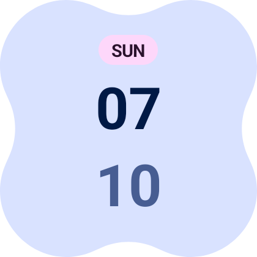 | 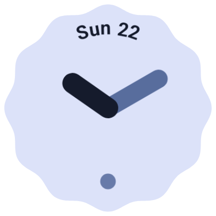 | 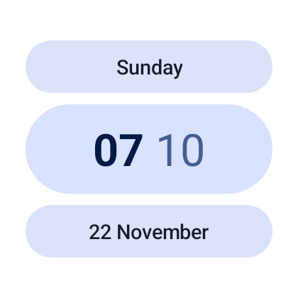 | 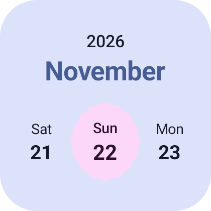 |

| Material You Clock & Battery Pill | Material You Date Pill | Material You Date & Clock Pill |
| :---: | :---: | :---: |
| 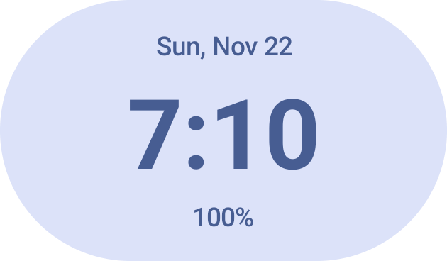 | 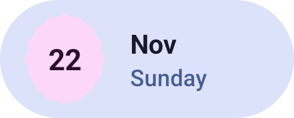 | 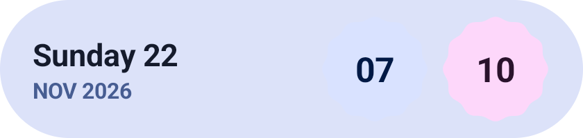 |

### Weather & Music
| Material You Weather | Material You Tilted Weather Pill | Material You Weather Pill |
| :---: | :---: | :---: |
| 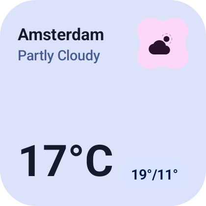 |  | 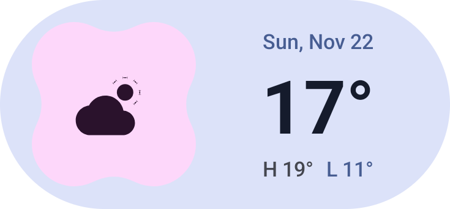 |

| Material You Music | Material You Music Pill |
| :---: | :---: |
| 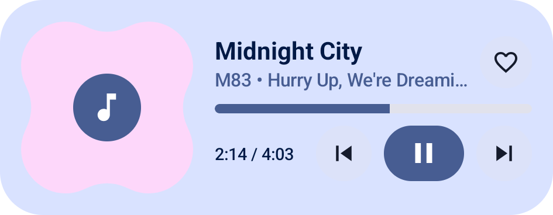 | 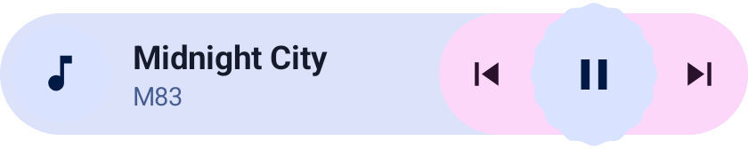 |

### Battery & System
| Material You Battery & Power | Material You Storage & RAM | Material You Storage Pill | Material You RAM Pill |
| :---: | :---: | :---: | :---: |
| 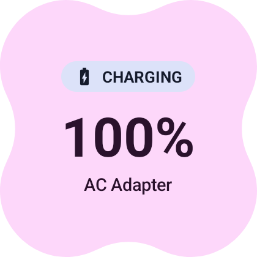 | 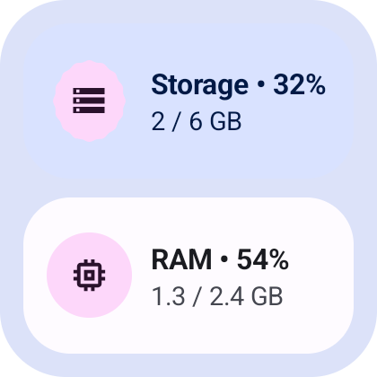 | 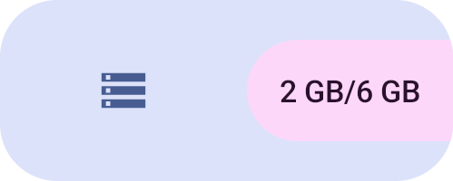 | 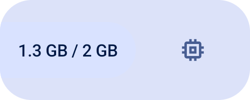 |

### Quick Buttons
| Wi-Fi | Mobile Data | Flashlight | Auto-Rotate | Bluetooth |
| :---: | :---: | :---: | :---: | :---: |
|  |  |  |  |  |

| Ringer Mode | Mute | Vibrate | Ring |
| :---: | :---: | :---: | :---: |
|  |  | 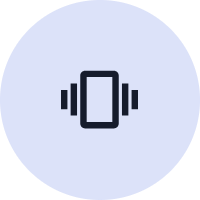 |  |

---

## 🛠 Tech Stack & Architecture

- **Language:** Kotlin 2.3+ (`jvmToolchain(17)`)
- **Widget Framework:** [Jetpack Glance](https://developer.android.com/develop/ui/compose/glance) (`androidx.glance:glance-appwidget` & `androidx.glance:glance-material3`)
- **In-App UI:** Jetpack Compose with Material 3 (`dynamicLightColorScheme` / `dynamicDarkColorScheme`)
- **State Persistence:** Jetpack DataStore Preferences (`PreferencesGlanceStateDefinition`)
- **Background Sync & Actions:** WorkManager (`CoroutineWorker`) & Glance `ActionCallback`
- **Memory Safety:** Two-stage `BitmapFactory` downsampling and `FileProvider` URI caching to stay well within Android's `RemoteViews` bitmap memory cap (`6 * W * H` bytes).

---

## 🚀 Getting Started

### Prerequisites
- **Android Studio** Ladybug / Meerkat or newer (AGP 9.0+) or **[Android CLI](https://developer.android.com/tools/agents/android-cli)**
- **JDK 17** or newer
- **Android SDK** Platform 36 (`minSdk = 26`, `targetSdk = 36`)

### Create & Manage the Emulator (Android CLI)
The VS Code workspace tasks (`.vscode/tasks.json`) are configured to use the `medium_phone` Android Virtual Device (AVD). You can create and manage it using the `android` CLI:

```bash
# List available hardware profiles (optional)
android emulator create --list-profiles

# Create the default medium_phone AVD
android emulator create medium_phone

# Verify the AVD is created
android emulator list

# Start / stop the emulator from the terminal (or via VS Code Tasks)
android emulator start medium_phone
android emulator stop medium_phone
```

### Build & Run
Clone the repository and build the debug APK using the Gradle wrapper:

```bash
git clone https://github.com/your-username/material-widgets.git
cd material-widgets

# Assemble Debug APK
./gradlew assembleDebug

# Run Unit Tests
./gradlew testDebugUnitTest
```

On Windows PowerShell:
```powershell
.\gradlew.bat assembleDebug
```

---

## 📂 Project Structure

```text
app/src/main/
├── kotlin/dev/shiqan/materialwidgets/
│   ├── MainActivity.kt                  # Companion showcase & widget pin app
│   ├── ui/
│   │   ├── main/                        # In-app widget gallery & preview cards
│   │   └── theme/                       # Material 3 Dynamic + Light/Dark Compose theme
│   └── widget/
│       ├── theme/WidgetTheme.kt         # MaterialYouGlanceTheme & ColorProviders
│       ├── util/WidgetBitmapUtils.kt    # Safe RemoteViews bitmap downsampling & fallback
│       ├── clock/                       # Material You Clock GlanceAppWidget & Receiver
│       ├── weather/                     # Material You Weather GlanceAppWidget & Actions
│       └── music/                       # Material You Music GlanceAppWidget & Actions
└── res/
    ├── drawable/                        # Expressive Material vector shapes & icons
    ├── values/                          # Dimensions, strings, and themes
    └── xml/                             # AppWidgetProvider info XMLs & FileProvider paths
```

---

## 📄 License

This project is licensed under the [MIT License](LICENSE).
